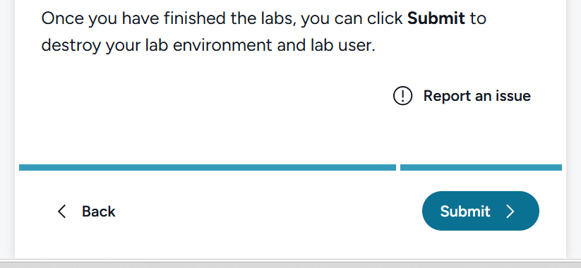

# Lab 3.3 ~ Build a Power BI Report on Gold

!!! info "You need your workspace and the `gold_revenue` table you built in Lab 3.1. Lab 3.2 is not required."

Gold exists to answer business questions - so put it in front of a business user. Power BI is built into Fabric, so you can report straight from your gold table.

## Step 1: Start a Power BI trial

You need a Power BI licence for this lab. The lab environment offers a free 60-day trial.

1. In the left navigation bar, select your workspace name to return to the workspace view.

2. Select **New item**.

3. In the filter box, type: `semantic`

4. Select **Semantic model**.

5. When you are offered a Power BI 60-day trial, accept it.

    !!! note "You only need the trial here - close the semantic model window once the trial is active. You create the semantic model in the next step."

## Step 2: Create a semantic model

A semantic model tells Power BI which tables to use and how to read them.

1. In the left navigation bar, return to your **HomeSphere** lakehouse.

2. Select **Analyze data with** and choose **SQL analytics endpoint**.

3. On the **Home** tab, select **New semantic model**.

4. Configure the semantic model:

    - **Name**: `HomeSphere Gold`
    - **Workspace**: *select your workspace*
    - Select only the `gold_revenue` table

5. Select **Confirm**.

!!! note "Why only gold?"
    Business users report from gold. Bronze and silver are for the data team - they are not the place to answer business questions.

## Step 3: Create the report

1. In the left navigation bar, select your workspace name to return to the workspace view.

2. Open the `HomeSphere Gold` semantic model.

3. Select **Create a report**, then choose to start with a blank report.

4. Build the following visuals. In the **Data** pane, expand `gold_revenue` and tick or drag the fields onto each visual:

    - A **Card** showing the sum of `line_value` - total revenue
    - A **Clustered column chart** with `category` on the X-axis and `line_value` on the Y-axis - revenue by category
    - A **Slicer** on `region`

5. Use the slicer to pick a region. Watch the card and the chart update.

6. Save the report as: `HomeSphere Revenue`

!!! success "Your report should show the same revenue by category as your SQL query at the end of Lab 3.1."

!!! tip "Because the report reads the gold table, the next time the pipeline runs, the report shows the new numbers - no one has to rebuild it."

---

## Clean up resources

In this exercise, you built a Power BI report on the gold table - the business-ready output of the medallion pipeline.

Once you have finished exploring, you should delete the workspace you created for this exercise.

1. Navigate to Microsoft Fabric in your browser.

2. In the bar on the left, select the icon for your workspace to view all of the items it contains.

3. Select **Workspace settings** and in the **General** section, scroll down and select **Remove this workspace**.

4. Select **Delete** to delete the workspace.

5. Return to the QA Platform and click **Submit** to destroy the lab environment.

!!! abstract ""
    
