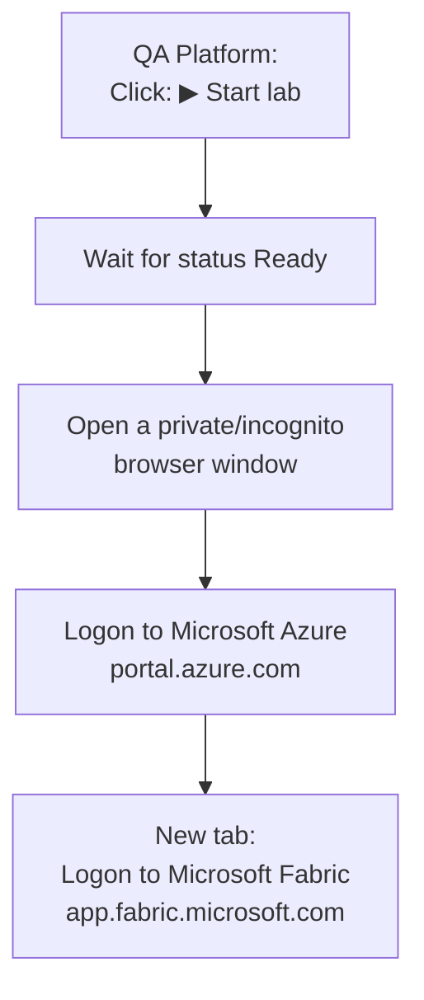
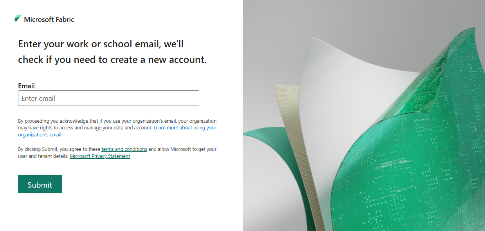
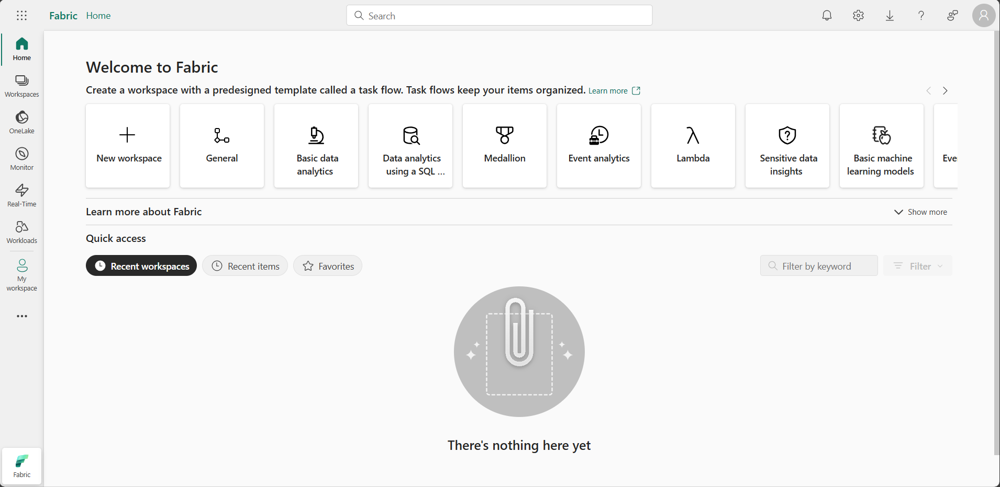

# MS Fabric Playground ~ Local Login Instructions

## Step 1: Access Microsoft Fabric

In this lab, you will access Microsoft Fabric using a temporary lab account provided by the QA Platform.

!!! note
    The **Open** button in the QA Platform opens the Azure portal in a normal browser window. Do not use it - sign in from a private browsing window instead, as shown below.

1. Navigate to the [QA Platform](https://bud.sso.app.qa.com/lab/microsoft-fabric-playground/) to access the **Microsoft Fabric Playground**.

2. Click **Start** to start the lab.

3. Wait until the lab status shows **Ready** with a green tick.

    - This can take up to 15 minutes from the time you start the lab. The provisioning assigns a Fabric licence to your lab user account.

    !!! warning "**Ready to log in** with a grey tick and a percentage is not ready - keep waiting!"

4. Make a note of your allocated **Username** and **Password**.

## Step 2: Logon to Microsoft Azure

1. Open a **private browsing window** (InPrivate in Edge, Incognito in Chrome).

2. Navigate to the [Microsoft Azure portal](https://portal.azure.com) at: https://portal.azure.com

3. When asked to sign in, paste the **Username** from the QA Platform into the email box and select **Next**.

    !!! warning "If you see an error saying your username is invalid:"
        - Check that you copied the **Username** exactly as shown on the QA Platform. If it still fails, please let your trainer know.

4. When prompted for a **Temporary Access Pass**, use the **Password** from the QA Platform.

    - If prompted to "Stay signed in?", select **No**. This ensures the session ends when the private window is closed.

    !!! success "You are now signed in to the **Azure portal**. This confirms your lab account is active."

## Step 3: Logon to Microsoft Fabric

1. In the same private browsing window, **open a new tab**.

2. Navigate to the [Microsoft Fabric home page](https://app.fabric.microsoft.com) at: https://app.fabric.microsoft.com

3. If asked to enter your email, paste the **Username** from the QA Platform into the **Email** box and select **Submit**.

    !!! abstract ""
        

    !!! warning "Do not sign up for a Microsoft Fabric Trial!"
        - If you are asked to do so, please let your trainer know.

4. After signing in, you should be redirected to the **Microsoft Fabric home page**:

    !!! abstract ""
        

    !!! tip "If Microsoft Fabric opens in the Power BI view instead:"
        - Select the icon at the bottom-left of the screen and choose **Fabric**.
